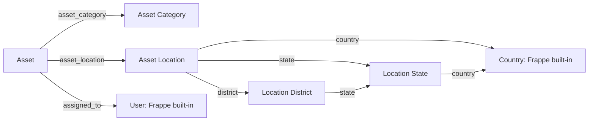
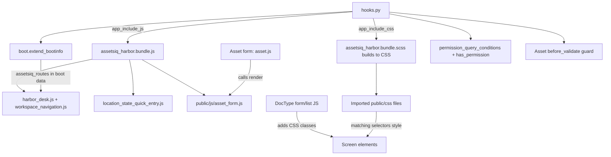
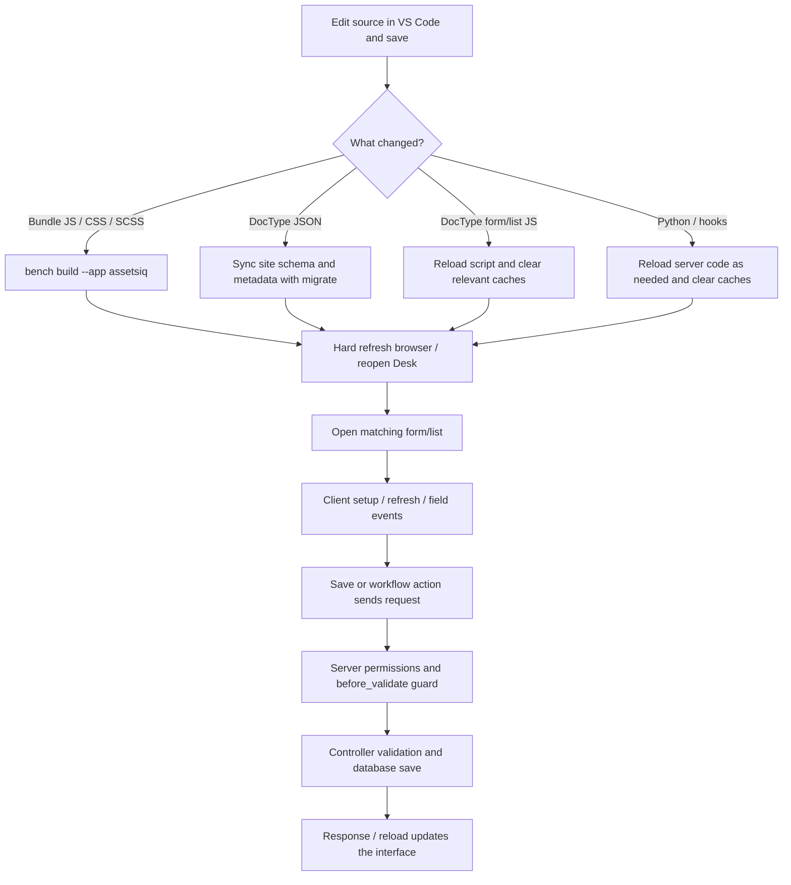

# AssetsIQ: a beginner’s guide to how your Frappe app fits together

Source snapshot: 4 November 2026. This guide describes the files in `/home/vin_user81/frappe-bench/apps/assetsiq`. It does not claim that every setup script has been run on your site. No database records or live browser screens were inspected or changed.

**Your app currently defines five DocTypes. Assets, assignments and maintenance share the Asset record; they are not five separate transaction modules.** Workflow transitions are requested from Frappe at runtime, so the complete active workflow must be checked in the site's Workflow screen.

## 1. Start with the vocabulary

| Term | Plain meaning | AssetsIQ example |
|---|---|---|
| App | A package of related features | `assetsiq` |
| Module | A grouping inside an app | AssetsIQ module containing your five DocTypes |
| DocType | The blueprint for records: fields, permissions and settings | Asset |
| Document | One record made from that blueprint | A laptop named `AST-00001` (illustrative ID) |
| Field | One piece of information on a record | `serial_number` |
| Link | A field pointing to another record | Asset's `asset_category` points to Asset Category |
| Controller | Python class containing server rules | `class Asset(Document)` |
| Client | The browser running JavaScript | Showing a confirmation dialog |
| Server | Python and the database behind the interface | Rejecting an asset without a required serial |
| Event | A moment when Frappe calls your code | Form `refresh`, document `validate` |
| Hook | A registration telling Frappe where to find app-wide code | `doc_events` in `hooks.py` |
| Desk | Frappe’s logged-in working interface | Lists, forms and workspaces |
| Bundle | Several source files built into a browser-loadable file | Harbor CSS and JavaScript bundles |
| Workflow | Configured states and allowed actions between them | Accept Assignment |

A DocType JSON is a **blueprint**, not a file holding all asset records. Records normally live in the site's database. A Link stores a record ID; the screen may display a friendlier title.

## 2. The file structure

Paths below start at `apps/assetsiq/`. The repeated `assetsiq` directories represent the repository, Python package and module; they are intentional.

```text
assetsiq/                              repository
├── README.md                          project notes; some sections describe earlier stages
└── assetsiq/                          app's Python package
    ├── hooks.py                       registrations and asset bundle loading
    ├── boot.py                        app route metadata for Desk
    ├── asset_permissions.py           Asset and Location access rules
    ├── geography.py                   shared State/District validation
    ├── fixtures/role.json             exported operational roles
    ├── setup/                         explicitly invoked setup/import helpers
    │   ├── desk.py, home.py, launcher.py, asset_navigation.py
    │   ├── geography.py, location_names.py
    │   ├── import_states.py, import_districts.py
    │   └── recipient_workflow.py
    ├── public/
    │   ├── assetsiq_harbor.bundle.js    JS build entry: imports shared scripts
    │   ├── assetsiq_harbor.bundle.scss CSS build entry: imports styles
    │   ├── js/
    │   │   ├── harbor_desk.js
    │   │   ├── workspace_navigation.js
    │   │   ├── location_state_quick_entry.js
    │   │   └── asset_form.js
    │   ├── css/                       shared and screen-specific styles
    │   └── dist/                      generated build output
    ├── desktop_icon/                  exported launcher definitions
    ├── workspace_sidebar/             exported sidebar definitions
    ├── www/assetsiq.py + assetsiq.html retained standalone web page
    ├── tests/                         additional verification scripts
    └── assetsiq/                      AssetsIQ module
        ├── doctype/
        │   ├── asset/
        │   ├── asset_category/         this guide is stored here
        │   ├── asset_location/
        │   ├── location_state/
        │   └── location_district/
        ├── page/assetsiq_home/         custom Desk Home page
        └── workspace/                 exported workspace definitions
```

### Every current DocType and its files

Each listed directory also has `__init__.py`, which makes it an importable Python package.

| DocType | Directory under `assetsiq/assetsiq/doctype/` | Actual files |
|---|---|---|
| Asset | `asset/` | `asset.json`, `asset.py`, `asset.js`, `asset_list.js`, `test_asset.py` |
| Asset Category | `asset_category/` | `asset_category.json`, `asset_category.py`, `asset_category.js`, `asset_category_list.js`, `test_asset_category.py` |
| Asset Location | `asset_location/` | `asset_location.json`, `asset_location.py`, `asset_location.js`, `asset_location_list.js`, `test_asset_location.py` |
| Location State | `location_state/` | `location_state.json`, `location_state.py`, `location_state.js`, `location_state_list.js`, `test_location_state.py` |
| Location District | `location_district/` | `location_district.json`, `location_district.py`, `location_district.js`, `location_district_list.js`, `test_location_district.py` |

### What each file does, and who creates it

| File | Purpose | Automatic versus manual |
|---|---|---|
| `<name>.json` | Fields, naming, form layout, permissions and other DocType settings | Frappe writes/exports standard DocTypes in developer mode when configured through the DocType editor. Developers can edit tracked JSON carefully and sync it. |
| `<name>.py` | Server controller; rules apply beyond the browser too | Frappe normally scaffolds the class. Developers write methods such as `validate`. |
| `<name>.js` | Browser form events and presentation | Frappe normally scaffolds the event registration. Developers add the behavior. |
| `<name>_list.js` | List columns, badges, filters and list events | Optional customization usually created and maintained by developers; its filename lets Frappe discover it. |
| `test_<name>.py` | Automated checks | Frappe can scaffold test classes. Developers write meaningful test cases. |
| `__init__.py` | Python package marker | Normally scaffolded; often empty. |
| `hooks.py` | App registrations | App creation supplies a template; developers enable/edit registrations. Commented examples do nothing. |
| `public/js/*`, `public/css/*`, bundle entries | Shared behavior and styling | Developer-maintained source, not automatically designed by Frappe. |
| `public/dist/*` | Optimized, hashed browser files | Build-generated. Edit the source, then rebuild. |
| Workspace/sidebar/icon JSON and fixtures | Exported site configuration | Can be exported/generated by Frappe or setup code; developers maintain reproducible definitions. |

These are Frappe conventions, not proof of who originally typed each file. The source alone does not establish its editing history. Your category, state and district test files and Asset test file currently contain placeholder test classes; Asset Location has real integration tests.

## 3. How the DocTypes relate

Arrows mean “contains a Link to,” not “inherits from.” Many assets can use one category or location.



| DocType | What it stores | Identity and important rules |
|---|---|---|
| Asset Category | Category name, serial-required checkbox, computer-specifications-required checkbox, description | ID comes from `category_name`; category name is unique. Python controller currently has `pass`: no custom category server method. |
| Asset | Name, category, location, assigned user, serial, status, description | ID pattern `AST-.#####`. Name/category/location/status are required. Serial is marked unique; conditional requirement comes from category and is checked again on the server. |
| Asset Location | Location name, country/state/district, address, description | Auto-increment ID. `location_name` is a friendly label, not the ID. Blank labels are suggested by Python. Legacy `naming_series` field is hidden by form JS. |
| Location State | State name, country, description | Hash ID. Country and state name required; duplicate names blocked within the same country. Parent country cannot change after creation. |
| Location District | District name and state | Hash ID. State and district name required; duplicate names blocked within the same state. Parent state cannot change after creation. |

**Important limits:** `computer_specifications_required` exists and is shown as a badge, but the inspected Asset fields/controller do not implement a computer specification collection or enforcement process. `assigned_to` links to **User**, not an Employee DocType.

## 4. Shared files, styles and hooks

### The loading connection



`app_include_*` loads resources into Desk. Loading globally does not mean every style visibly applies everywhere: classes and selectors scope most AssetsIQ changes to its screens.

| Shared file | Actual connection and visible effect |
|---|---|
| `hooks.py` | Loads both bundles; registers boot metadata, roles fixture, launcher, Asset/Location permission functions and Asset `before_validate`. |
| `boot.py` | `extend_bootinfo` discovers module DocTypes, workspaces, pages and reports. Browser branding uses `frappe.boot.assetsiq_routes` to recognize app screens. This is route metadata, not a permission grant. |
| `public/js/harbor_desk.js` | Adds `aiq-assetsiq-shell` on app routes, sets branding and short workspace labels; restores labels outside app routes. |
| `public/js/workspace_navigation.js` | Builds Home/workspace navigation from its mapping and allowed workspaces; hides unreadable DocType items. My Assets route includes the current assigned user filter. Server permissions still enforce access. |
| `public/js/asset_form.js` | Exposes `frappe.assetsiq_asset_form`; builds Asset header, status notice, summary and tab-specific guidance. `asset.js` calls these helpers. These are app functions attached to `frappe`, not built-in Frappe APIs. |
| `public/js/location_state_quick_entry.js` | Extends Frappe's state Quick Entry class, calls the original dialog renderer, then adds a styling class. |
| `asset_permissions.py` | Filters lists, checks individual records and restricts employee changes before validation. |
| `geography.py` | Reused by State and District controllers to normalize labels and protect hierarchy/uniqueness. |
| `assetsiq/page/assetsiq_home/*` | JSON defines a Desk Page; JS creates its page and uses the shared navigation helper's workspace cards. |
| `www/assetsiq.py` and `.html` | Separate website route `/assetsiq`; Python redirects guests and prepares role/name context. README says these are retained from an earlier standalone experiment, not linked from the Desk workspace. |
| `setup/*.py` | Administrative setup, import and repair helpers. Merely existing here does not run them during every save, login or migration. No active install/migrate hook registers them in this `hooks.py`. |

### Where styling belongs

The **loading mechanism is shared**, while styles can be shared or screen-specific. A DocType does not need its own automatically loaded CSS file.

The active SCSS entry imports these CSS sources:

| CSS source in `public/css/` | Intended scope |
|---|---|
| `harbor_desk.css` | Shared app Desk shell and design |
| `executive_list.css` | Common list action bars and inputs |
| `workspace_navigation.css` | Sidebar and workspace/Home presentation |
| `location_state.css`, `location_state_list.css` | State form/Quick Entry and list |
| `location_district.css` | District presentation |
| `asset_category_list.css` | Category presentation |
| `asset_location.css` | Location form and list |
| `asset_form.css`, `asset_list.css` | Asset form and list |

For example, category form JS adds `aiq-category-form`; selectors in loaded styles can target that class. State Quick Entry adds `aiq-location-state-dialog`, allowing popup-specific styling.

`harbor.css` and `mi.css` also exist but are not imported by this SCSS entry. A file’s presence does not establish active loading through the Desk bundle; retained pages may reference assets separately. Do not assume every CSS file affects every screen.

SCSS is CSS source with extra build features. Your entry mainly assembles imports. The build produces CSS that the browser understands. Hashed filenames change when contents change, helping browsers load the new version.

## 5. Main DocType → file → event → result map

All paths here are relative to the app's Python package (`apps/assetsiq/assetsiq/`).

| DocType/scope | File | Function or event | Purpose and when it runs | Visible result |
|---|---|---|---|---|
| Asset Category | `assetsiq/doctype/asset_category/asset_category.json` | `autoname`, field metadata | Defines the blueprint, synchronized into the site | Category name and requirement checkboxes |
| Asset Category | same folder, `asset_category.js` | Form `refresh` | Adds banner/guide; shows category identity, makes saved name read-only; adjusts sidebar/layout | Guided category form |
| Asset Category | `asset_category_list.js` | List `onload`, `refresh`, `formatters` | Creates introduction, updates filters and description previews; formats checkboxes | Required/Not required badges |
| Asset Category | `asset_category.py` | `AssetCategory(Document)` | Uses inherited behavior; no custom methods | Standard save behavior |
| Asset | `assetsiq/doctype/asset/asset.json` | `fetch_from`, `mandatory_depends_on`, `unique` | Fetches category serial rule; marks serial mandatory conditionally and unique | Serial requirement in form; duplicate nonempty serial rejected |
| Asset | `asset.py` | `Asset.validate` | Reads trusted category rule, checks serial/status/user; clears recipient on specified return to Available | Invalid saves blocked; assignment cleared on applicable return |
| Asset | `asset.js` | Form `refresh` | Filters recipient selection and retrieves permitted workflow actions | Correct user choices and action buttons |
| Asset | `asset.js` | `asset_name`, `asset_category`, `assigned_to`, `serial_number`, `serial_number_required`, `asset_status`, `asset_location` | Field-change handlers call shared render | Header/summary/guidance follow edits |
| Asset | `asset.js` | `on_tab_change` | Calls shared guidance renderer | Guide matches active tab |
| Asset | `asset_list.js` | List `onload`, `refresh`, formatter, button action | Builds status tabs, fetches permission-filtered counts, decorates rows | My Assets/inventory headings, status counts, recipient display |
| Asset Location | `assetsiq/doctype/asset_location/asset_location.js` | Form `setup` | Registers state/district Link filters | Matching geography choices |
| Asset Location | `asset_location.js` | `refresh`, `country`, `state` | Refresh enables fields and renders design; parent edits clear children | No stale child selection after country/state edit |
| Asset Location | `asset_location.py` | `validate`, `suggest_location_name` | Normalizes/suggests name and checks parent relationships | Consistent name; mismatched geography rejected |
| Asset Location | `asset_location_list.js` | List `onload`, `refresh` | Adds intro, search hints and address/description previews | Easier location browsing |
| Location State | `assetsiq/doctype/location_state/location_state.py` | `validate`, `on_doctype_update` | Uses shared geography rules; adds compound unique constraint during schema update | No duplicate state within country; parent protected |
| Location State | `location_state.js`, `location_state_list.js` | Form `refresh`, list `onload` | Adds guide/classes, introduction and search hints | Styled state form/list |
| Location District | `assetsiq/doctype/location_district/location_district.py` | `validate`, `on_doctype_update` | Same shared rules, uniqueness within state | No duplicate district within state; parent protected |
| Location District | `location_district.js`, `location_district_list.js` | Form `refresh`; list `onload`, `refresh` | Adds banner, classes and filter hints | Styled district form/list |
| Asset/Location security | `asset_permissions.py` via `hooks.py` | Query conditions, permission checks, `before_validate` | Checks reads/writes and employee transitions on the server | Employees see/act only on permitted own records |

`refresh` may run repeatedly. Most rendering helpers remove or check for their own previous markup to avoid duplicate banners. `setup` establishes form queries early. Field-name events run when that field changes, not just because a similarly named file exists.

## 6. Practical walkthroughs from the code

### A. Register a laptop: category → serial rule → server validation

Illustrative data: category **Laptop**, serial-required checked; an Asset named **Office Laptop**.

Actual JSON on Asset contains the equivalent metadata:

```json
{"fieldname": "serial_number_required", "fetch_from": "asset_category.serial_required"}
```

The serial field uses `mandatory_depends_on: "eval:doc.serial_number_required == 1"`. This is a metadata expression, not a Python function.

Actual server logic from `asset.py`:

```python
serial_required = frappe.db.get_value(
    "Asset Category", self.asset_category, "serial_required",
)
self.serial_number_required = int(serial_required or 0)
serial = (self.serial_number or "").strip()
if serial == "0":
    frappe.throw(_("Serial Number cannot be 0."))
```

1. The category Link identifies the category record.
2. Frappe fetches its checkbox for the form's conditional requirement.
3. Saving invokes `Asset.validate` on the server.
4. `frappe.db.get_value` reads the category's current saved rule again. The server does not trust a browser-edited checkbox.
5. `int(... or 0)` turns an empty/false rule into zero.
6. `strip()` ignores surrounding spaces for these checks; this snippet does not itself rewrite the stored serial.
7. `frappe.throw` stops the save if the serial is `0`. The following actual branch also stops saving a missing required serial.
8. `_()` marks the message for translation. JSON's unique setting separately protects serial uniqueness through Frappe/database validation.

Visible result: a Laptop category requiring a serial cannot be saved as an Asset with a blank serial, including when a save arrives through an import or API.

### B. Choose an office: country → state → district

Actual form code from `asset_location.js`:

```javascript
setup(frm) {
    frm.set_query("state", () => ({
        filters: { country: frm.doc.country || "" }
    }));
    frm.set_query("district", () => ({
        filters: { state: frm.doc.state || "" }
    }));
},
async country(frm) {
    await frm.set_value({ state: null, district: null });
    update_location_geography_controls(frm);
}
```

1. `frappe.ui.form.on("Asset Location", {...})` registers these handlers.
2. `frm` is the current form; `frm.doc` holds the record values in the browser.
3. `set_query` supplies search filters when a Link dropdown is used. The callback reads the current parent, rather than an old copied value.
4. Selecting a different country triggers `country(frm)`.
5. `set_value` clears both children; `await` waits for that update before adjusting controls.
6. The helper uses `toggle_enable`: State needs Country; District needs both Country and State.
7. Python's `AssetLocation.validate` checks the actual state country and district state again using `db.get_value` and `throw`.

Visible result: selecting India limits states to those belonging to India; changing country clears the selected state/district. Country-only locations remain allowed. A bypassed browser filter still cannot save inconsistent geography.

### C. Allocation and employee acceptance: one Asset, not a separate allocation record

Current presentation guides IT to choose an enabled System User, save the Available Asset, then use Request Assignment. The browser retrieves actual authorized transitions:

```javascript
const transitions = await frappe.xcall(
    "frappe.model.workflow.get_transitions", {doc: frm.doc}
);
```

When an action button is confirmed, the actual code calls:

```javascript
const doc = await frappe.xcall("frappe.model.workflow.apply_workflow", {
    doc: frm.doc, action,
});
frappe.model.sync(doc);
await frm.reload_doc();
```

1. `refresh` avoids action generation for new/unsaved edits using `is_new()` and `is_dirty()`.
2. `xcall` calls a server method and returns its result asynchronously.
3. `get_transitions` asks the configured workflow which actions are currently allowed.
4. Extra client checks restrict recipient actions to the selected user and respect self-approval settings.
5. `add_custom_button` displays those actions. `confirm` asks the user before applying one.
6. `apply_workflow` requests the server-side transition; a button does not itself grant authorization.
7. `model.sync` updates browser document data; `reload_doc` fetches the saved record and redraws it.
8. `show_alert` reports success. Decline Assignment instead routes to the Asset list because the employee may lose access after declining.

The employee guard explicitly permits these old/new status pairs:

```text
Assignment Requested → Assigned                accept
Assignment Requested → Available               decline
Assigned             → Maintenance Requested   request maintenance
```

It compares `get_doc_before_save()` with current values and blocks changes to other metadata fields, excluding `asset_status` and the recalculated `serial_number_required`. Link values are normalized with `frappe.utils.cstr` before comparison.

`Asset.validate` clears `assigned_to` when a previously Assignment Requested or Assigned record becomes Available. The hook guard runs **before** that controller validation, so it can verify the original employee assignment before it is cleared.

These code rules exist. Whether the site currently offers every expected transition also depends on its active Workflow and permissions.

### D. Maintenance: state changes on the same Asset

The code supports the recipient action **Request Maintenance**, and recognizes statuses Maintenance Requested and Under Maintenance. `asset.js` also prioritizes labels Approve Maintenance and Complete Maintenance if returned by the workflow.

1. An assigned employee opens their Asset.
2. The server provides allowed transitions.
3. Request Maintenance submits `apply_workflow`.
4. The employee guard accepts Assigned → Maintenance Requested if other asset details were not edited.
5. The shared renderer changes the notice to say IT will review the request.
6. An IT user sees further actions only when allowed by the active workflow.

There is no inspected Maintenance DocType storing technician, repair cost, service dates or repair line items. Approval/completion destinations cannot be established from button labels alone.

### E. Transfers: what exists and what you could add

**Current:** an Asset has `asset_location` and `assigned_to` Links. Authorized IT changes can update record data subject to workflow and permissions. Employees cannot use their workflow save to change those details. No transfer document/controller was found.

**Proposed:** add Asset Transfer with Asset, old/new location, old/new recipient, reason, requested-by and approval state. On authorized approval, a server method could update the Asset and retain a transfer history. This is a design suggestion, not current code; do not assume transfers already have approvals or history records.

### F. Why two states with the same name can be valid

Actual shared rule in `geography.py` normalizes whitespace, checks parent changes and searches for duplicates. The State controller calls:

```python
def validate(self):
    validate_reference(self, "state_name", "country")

def on_doctype_update():
    frappe.db.add_unique(
        "Location State", ["country", "state_name"], "unique_state_country"
    )
```

1. Saving a State invokes `validate_reference` with its label field and parent field.
2. `doc.get` reads the label; `doc.set` stores the normalized label.
3. `doc.has_value_changed` blocks changing Country on an existing record.
4. `db.exists` looks for another record with the same normalized label and country, excluding this record's own ID.
5. `throw(..., frappe.DuplicateEntryError)` provides a helpful duplicate error.
6. During DocType schema update, `db.add_unique` also enforces the pair at database level, including competing simultaneous inserts.

District follows the same pattern with State as its parent. `on_doctype_update` is a schema-update callback, not an event on every State/District record save.

## 7. Frappe API and event reference

This reference groups calls doing the same job. Locations refer to the files above. Small examples are explanatory snippets; full production handlers remain in the source. Properties such as `frappe.session.user`, `frappe.boot` and `frm.doc` are data, not functions. `$()`, `.addClass()`, `.find()`, `.append()`, `.prop()` and `.html()` are jQuery/DOM operations, not Frappe APIs.

### Browser APIs

| Function/event | Where and when | Plain purpose; step-by-step example |
|---|---|---|
| `frappe.ui.form.on` | All five form JS files; script registration, then matching events | Registers handlers. Example: register Asset Location → change Country → its `country` handler clears children (walkthrough B). |
| `setup`, `refresh`, field events, `on_tab_change` | Location setup; all forms refresh; Asset/Location field changes; Asset tabs | Setup establishes queries; refresh redraws; field/tab handlers react to edits/navigation. Example: change Asset name → `asset_name` → shared `render` → header changes. |
| `frm.set_query` | Asset refresh; Location setup | Filters Link choices. Example: assigned-to dropdown → filters enabled System Users → excludes Guest/Administrator. Server validation repeats this rule. |
| `frm.set_value`, `toggle_enable` | Location parent-change handlers and helper | Change values and enable controls. Example: change State → clear District → enable District when parent exists. |
| `frm.toggle_display`, `set_df_property`, `layout.refresh_sections` | Category refresh; Location hides naming series | Adjust visible/editable form fields. Example: saved category → set category name read-only → refresh layout. Native Rename is the intended ID-change route. |
| `frm.is_new`, `is_dirty` | Asset workflow and presentation; other form presentation | Test unsaved identity/edits. Example: edit an Asset → dirty check prevents action → save/reload before workflow. |
| `frm.dashboard.add_section`, `show` | All form presentations, including shared Asset renderer | Add/show custom dashboard content. Example: refresh → remove old custom intro → add banner → show dashboard. |
| `frm.get_active_tab` | Shared Asset guidance, optional call | Read selected tab. Example: open Identification → get tab fieldname → display serial guidance. |
| `frm.add_custom_button`, `remove_custom_button` | Asset refresh | Maintain workflow buttons. Example: clear previous labels → retrieve transitions → add each allowed action once. |
| `frappe.xcall` | Asset form/list | Call server asynchronously. Example: list sends grouped `frappe.client.get_list` request → receives counts → updates tab badges. Form usage is in C. |
| `frappe.model.workflow.get_transitions`, `apply_workflow` | Server endpoints called by Asset JS | Return allowed actions/apply selected action. Example: retrieve Accept Assignment → confirm → apply → reload (C). |
| `frappe.client.get_list` | Asset list via `xcall` | Permission-aware query. Example: preserve non-status filters → group by `asset_status` → show counts for the permitted scope. |
| `frappe.confirm`, `msgprint`, `show_alert` | Asset action handlers | Confirm choice, explain blocked dirty action, show outcome. Example: click action → confirm → server saves → green success alert. |
| `frappe.model.sync`, `frm.reload_doc` | Asset workflow success | Refresh browser data from the result/server. Example: workflow returns Assigned document → sync → reload → new status appears. |
| `frappe.listview_settings` | All five `_list.js` files | Configuration registry, not a function. Example: category config requests rule fields → formatter builds Required badges. |
| List `onload`, `refresh`, `formatters`, `button.action` | List settings; State currently only customizes onload | Initialize list, update decorations, display values and open record. Example: Asset Open asset button → `set_route("Form", "Asset", doc.name)`. |
| `listview.filter_area.get`, `clear`, `set`; `listview.refresh` | Asset list status tabs | Read/replace filters and reload results. Example: click Maintenance → retain recipient filter → add maintenance statuses → refresh. |
| `frappe.set_route`, `get_route`, `router.on("change")`, `router.slug` | Asset navigation and shared navigation/branding | Navigate/read routes, react to navigation, convert names to URL-friendly strings. Example: route changes → recognize app → apply sidebar branding. |
| `frappe.after_ajax` | Shared navigation/branding initialization | Schedule work after pending requests finish. Example: boot requests finish → observe sidebar → schedule render. It is not a scheduled background job. |
| `frappe.model.can_read` | Shared navigation | Client metadata check for menu visibility. Example: user cannot read DocType → remove its navigation item. Server remains authority. |
| `frappe.utils.generate_route`, `icon` | Workspace navigation | Build list URLs and icon markup. Example: My Assets → route with assigned-user filter → render link with list icon. |
| `frappe.utils.escape_html`, `get_link_title` | Lists/shared Asset presentation; latter optional | Safely display text; resolve friendly Link title. Example: recipient ID → friendly title if cached → HTML-escape → render label. |
| `frappe.utils.is_xs`, `is_sm` | Category refresh | Detect small screen layout. Example: mobile → preserve sidebar overlay parent → desktop → initially hide record-tools sidebar. |
| `frappe.ui.form.QuickEntryForm`, `render_dialog`, `super.render_dialog` | State Quick Entry subclass | Extend popup while preserving native behavior. Example: Frappe selects named State subclass → original dialog renders → custom CSS class added. |
| `frappe.pages["assetsiq-home"].on_page_load`, `frappe.ui.make_app_page` | Home Page JS | Create custom Desk page. Example: open Home → make single-column page → insert shared workspace cards; wrapper `show` refreshes cards. |
| `__()` | Browser files | Translation helper. Example: `__("Required")` → translated label → escaped badge text. |

Shared scripts also listen for document events `page-change`, `app_ready`, `sidebar_setup`, and `sidebar-expand` with app-specific namespaces. They schedule branding/navigation updates. Browser `MutationObserver` watches sidebar changes; `requestAnimationFrame` batches repaint work. Those two are browser APIs, not Frappe methods. The Home wrapper's `show` event is a UI event, distinct from document validation.

### Server APIs and document methods

| Function/method | Actual locations and timing | Plain purpose; example steps |
|---|---|---|
| `Document`, `validate` | Five controller classes; four custom validators | Standard record behavior plus app rules before saving. Example: Asset save → read category → reject missing serial (A). Category inherits standard behavior without a custom validator. |
| `frappe.db.get_value` | Asset/Location controllers, permissions, setup, test verification | Read selected field(s). Example: assigned user ID → read enabled/type → reject invalid recipient. |
| `frappe.throw`, `_` | Controllers, geography, permissions, website/setup | Raise error, optionally translated. Example: district belongs to another state → translated message → save stops. |
| `get_doc_before_save`, `has_value_changed`, `is_new` | Asset controller, employee guard, geography/permissions | Inspect old record/change status. Example: existing State changes country → detect change → block reparenting. |
| `doc.get`, `set`, `meta.get_label`, `as_dict` | Geography, suggested names, guard/setup | Read/write document values, get readable field labels, expose values as a dictionary. Example: normalize state label → compare other saved records → use readable label in error. |
| `frappe.db.exists`, `add_unique` | Geography, Location permission; State/District schema callbacks | Check for records and enforce uniqueness. Example: same state/country pair → exists detects duplicate; database constraint also protects it (F). |
| `frappe.get_roles`, `frappe.session.user` | Permissions, launcher and website | Roles API plus current-user data. Example: IT role → broad scripted access; employee → own-recipient condition. Other DocType permissions/workflow settings also apply. |
| `frappe.db.escape`, `frappe.utils.cstr` | `asset_permissions.py` | Quote user value for SQL; normalize text values for comparison. Example: current email → escaped SQL literal → safe query restriction. |
| Permission hook functions | Asset/Location via `hooks.py` | Query functions restrict list rows; `has_permission` functions check individual documents. Example: employee asset list → assigned-to/status condition → only matching assets returned. Location access requires use by a visible own asset. |
| `before_validate` | Asset `doc_events` hook | Run employee guard before controller validation. Example: decline → verify original recipient/unchanged details → controller can then clear recipient (C). |
| `frappe.get_all` | Boot metadata, setup imports, tests | Fetch records without standard per-record permission filtering. Example: server boot helper queries module-owned screen names → sends route metadata. Do not copy this into a user-facing asset query as an access filter. |
| `frappe.get_doc`, `new_doc`; document `insert`, `save`, `reload`, `append` | Setup helpers and real Location tests | Load/create/change documents, append child rows, persist or reread. Example: recipient setup loads Workflow → appends missing IT transition → saves. Insert/save normally invoke document validation. |
| `frappe.only_for` | Setup helpers | Require an administrative role before a setup task. Example: helper starts → System Manager check → permitted setup continues. |
| `frappe.clear_cache`, `reload_doc` | Setup helpers | Invalidate metadata/cache; reload a DocType definition from app files. Example: setup syncs definition → clears metadata → subsequent loads see configuration. Python `frappe.reload_doc` differs from browser `frm.reload_doc`. |
| `frappe.db.commit`, `rollback`, `set_value`, `count` | Administrative setup/import helpers | Finalize/undo transactions, update directly, count records. Example: import batch → create validated documents → commit; caught error → rollback where coded. Direct `db.set_value` does not run a normal controller save lifecycle. |
| `frappe.rename_doc`, `scrub`, `as_json`, `get_meta`, `_dict` | Setup helpers | Rename linked records through framework; normalize names; serialize backups; read schema; create attribute-access dictionary. Example: backup document → `as_json` → write backup before setup edits. |
| `extend_bootinfo` | Hook → `boot.py` during Desk boot | Add custom boot metadata. Example: load module screens → assign `bootinfo.assetsiq_routes` → browser can identify app routes. |
| `get_context`, `frappe.Redirect`, `get_cached_value` | `www/assetsiq.py` when website route is requested | Prepare template data, redirect guests, fetch display name efficiently. Example: guest visits → redirect to login; allowed user → roles determine workspace label → name enters context. |
| `IntegrationTestCase`, `setUp`, `frappe.set_user`, `generate_hash`, `has_permission`, `search_link` | Real Asset Location tests | Test lifecycle, identity setup, unique test labels, authorization and native Link filtering. Example: create two countries' test states → impersonate employee → assert read/select allowed but create/write denied → restore Administrator. `search_link` is imported from `frappe.desk.search`. |

Test assertions such as `assertEqual`, `assertFalse` and `assertRaises` come from the testing framework. Tests run only when invoked, not when an employee opens a form. Existing Location tests cover mismatched hierarchy, duplicate scope, immutable parents, Link queries and role permissions. Placeholder test classes are not evidence those features passed tests.

`frappe.assetsiq_asset_form.*`, `frappe.assetsiq_asset_list.*` and `frappe.assetsiq_navigation.*` are your app's own helper namespaces. Examples: `render` updates the Asset display; `apply_tab` changes status filters; `home_markup` produces workspace-card HTML. Assigning them under `frappe` makes them accessible to other browser files; it does not make them framework-provided methods.

## 8. How a VS Code edit reaches Frappe



The save path is simplified: Frappe also performs standard link checks, metadata validation and workflow checks. A failed rule stops the save; client-only HTML changes do not save records.

**Reference commands, not executed for this guide:** run from `/home/vin_user81/frappe-bench`, replacing `<site>` with your actual site.

```bash
# After changing bundle sources or imported CSS/JS:
bench build --app assetsiq
bench --site <site> clear-cache

# After deliberate DocType schema/metadata changes:
bench --site <site> migrate
```

Then hard-refresh the browser and reopen the affected screen. Python changes may need a server process restart in a production deployment; a development server may reload them. Hook/boot changes can require a fresh Desk boot. Migration changes the database schema: use the correct site and your normal backup/deployment process. You do not need to migrate for every text/color change.

Example: to change the Asset header color, edit `public/css/asset_form.css` → its existing SCSS import includes it → build bundle → clear cache/reload → open an Asset → `asset.js` calls shared renderer → matching CSS styles the header.

Example: to change an assignment rule, edit the relevant Python guard/controller and review the active Workflow. Changing a visible button label alone does not change server authorization.

## 9. Current implementation versus future development

| Area | Present in inspected source | Proposed or needs separate verification |
|---|---|---|
| Asset inventory | Asset DocType, category/location links, serial validation, list tabs/count requests | Verify live records, deployed assets and site configuration |
| Allocation | `assigned_to` User Link, assignment statuses, workflow API calls and employee guard | Separate allocation document, dates and issue/return receipts would be new features |
| Employee requests | Recipient accepts/declines an assignment and requests maintenance on their own Asset | General request catalog, request for an unassigned asset, and separate request DocType are not present |
| Maintenance | Statuses, request action support, status notices and workflow-driven buttons | Repair log, technician/cost tracking and separate Maintenance DocType are not present |
| Transfers | Current Asset location/recipient fields | Dedicated transfer approvals/history are proposed |
| Computer specifications | Category checkbox and list badge | Asset specification fields/enforcement are not implemented in the inspected controller/schema |
| Geography | Hierarchical Links, client filters, server checks, duplicate constraints and real tests | Actual imported countries/states/districts and completed setup require site inspection |
| Roles and navigation | Two operational role fixtures; workspace/sidebar/icon definitions; shared Home page/navigation | Actual user role assignments and whether all setup helpers ran require database verification |
| Workflow | Calls to native workflow APIs, recognized labels/statuses, transition guard, recipient setup helper | Complete active Workflow definition is not exported in the inspected fixtures; inspect it in Desk before asserting all transitions |
| Automation | No active scheduler or install/migration hooks in this `hooks.py` | Scheduled maintenance reminders or automatically running setup would need explicit implementation |

The README includes older development-stage statements. For this guide, active source definitions take priority over those historical statements. Exported workspace files can also differ from live database customizations.

## 10. A simple learning route

1. Open `asset_category.json` and locate `serial_required`; compare it with the checkbox on the category form.
2. Read `asset_category.js` → `refresh`: notice how it changes presentation without a custom category Python validator.
3. Follow Asset's category Link and `fetch_from` in `asset.json`.
4. Read `Asset.validate` to see why a browser cannot bypass the serial rule.
5. Follow Location's `setup`, `country`, and `state` handlers, then its Python validator.
6. Read the active entries at the top and bottom of `hooks.py`; ignore commented sample registrations.
7. Follow the SCSS imports and JS bundle imports to their shared files.
8. Inspect the site's Workflow for Asset to connect its actual states/actions with `get_transitions`, `apply_workflow` and the employee guard.

The core connection to remember is: **JSON defines the record; form/list JavaScript shapes browser interaction; Python enforces server rules; hooks connect shared services; bundles deliver shared presentation; the database stores documents and site configuration.**
